# SwiftUI AI Assistant UI Kit

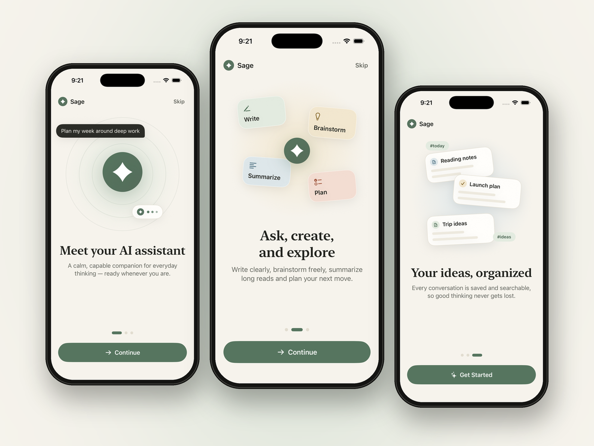
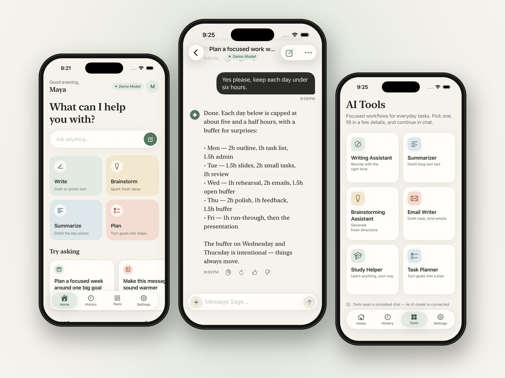
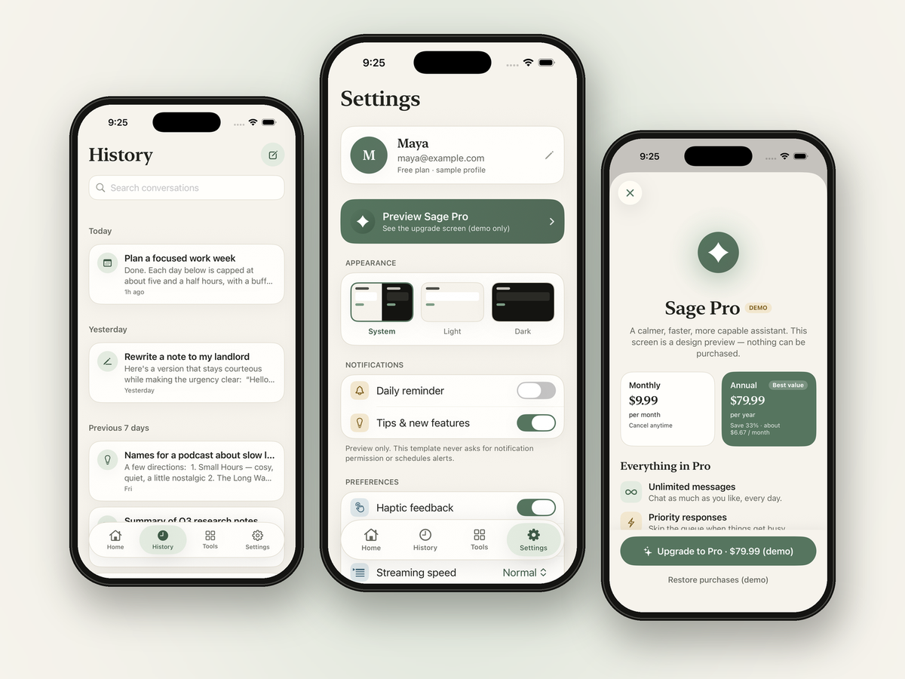
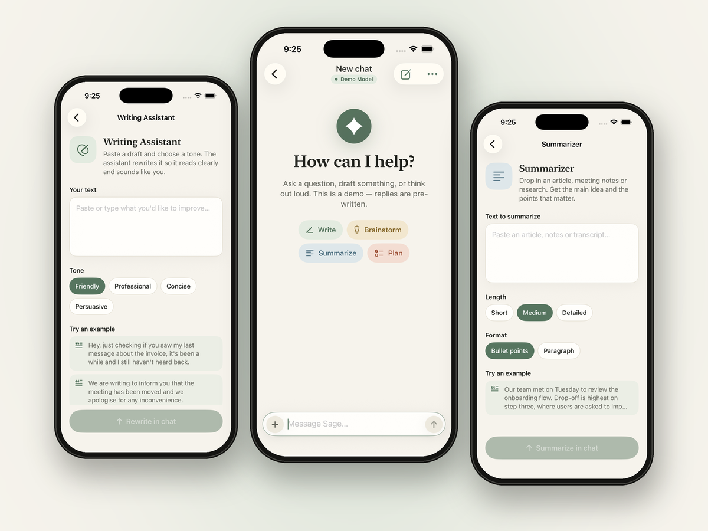

A premium, frontend-only SwiftUI template for building beautiful AI assistant apps.

**[Get the full source code on Gumroad](https://qinqin4.gumroad.com/l/yzuvug)**

## What's included

- 7 screens: onboarding (3 pages), home, chat, history, 6 AI tools, premium preview, settings
- Simulated streaming chat with typing indicator, copy, regenerate and stop
- Search, rename and swipe-to-delete in conversation history
- Light and dark mode with one cohesive visual identity
- 11 reusable SwiftUI components and a centralized design system
- Full Xcode source project with documentation

Requirements: Xcode 16+, iOS 17+, Swift 6.

## Please note

This is a UI template. It does **not** include a real AI model, networking, login, database or payments. Replies are demo content, and a clear integration point is provided so you can plug in your own AI backend.

## All screens

### Welcome flow

  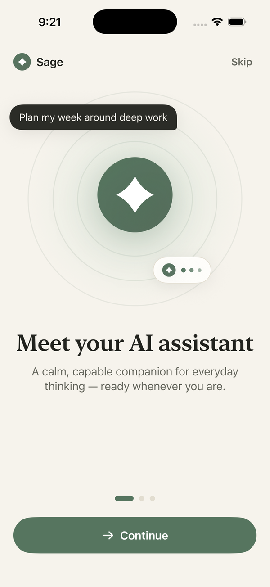
  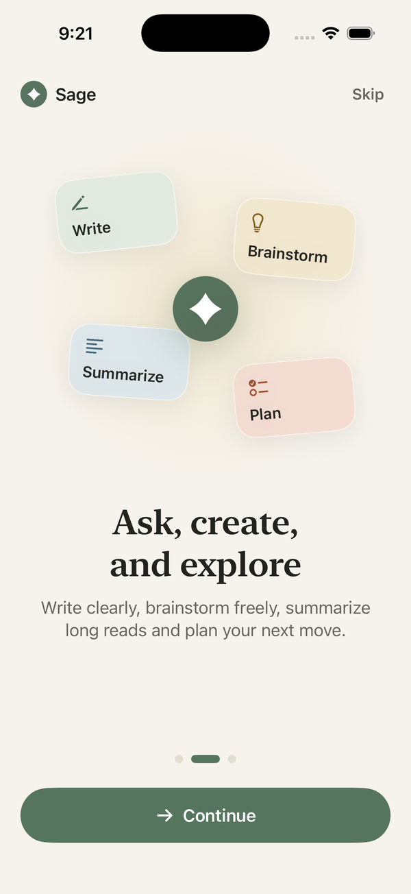
  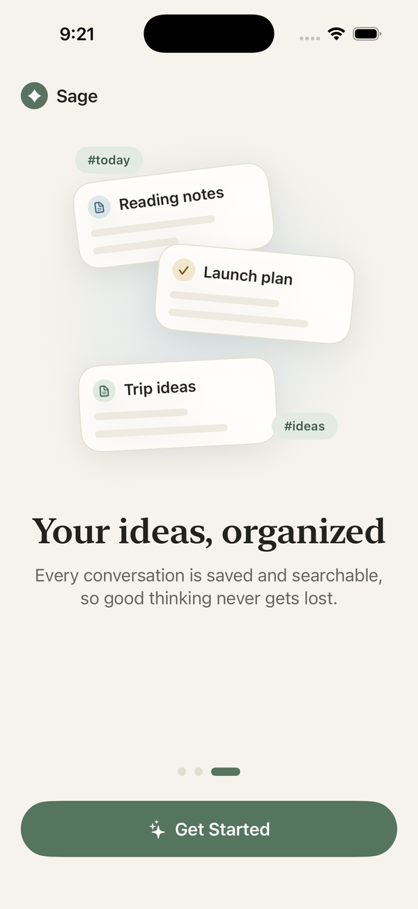

### Main tabs: Home, History, Tools, Settings

  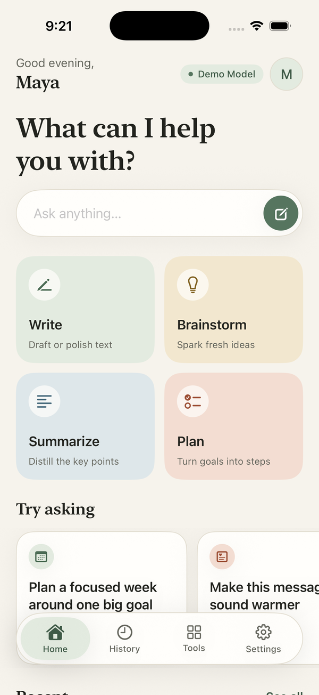
  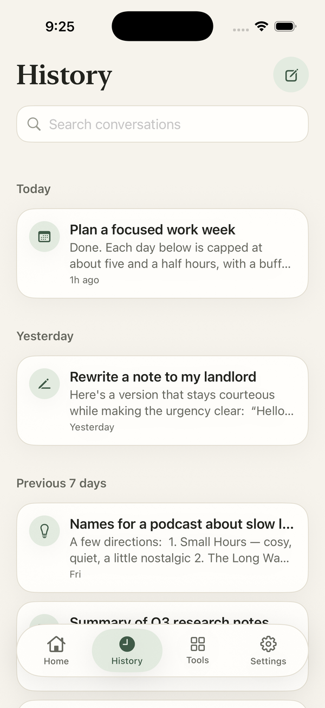
  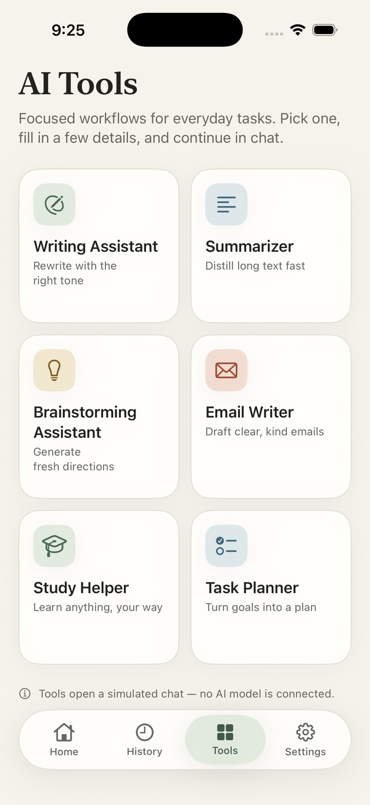
  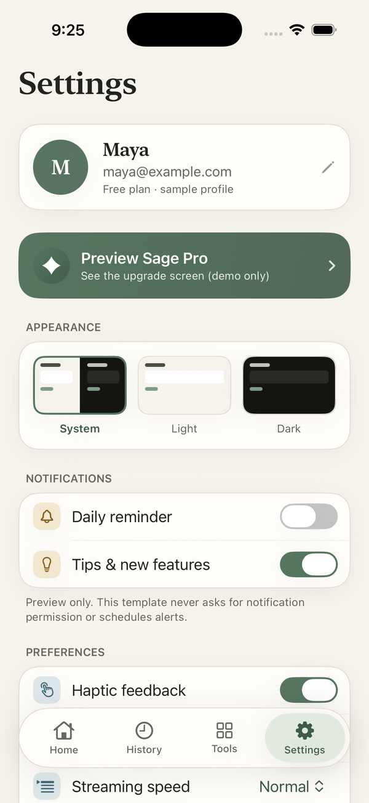

### Chat

  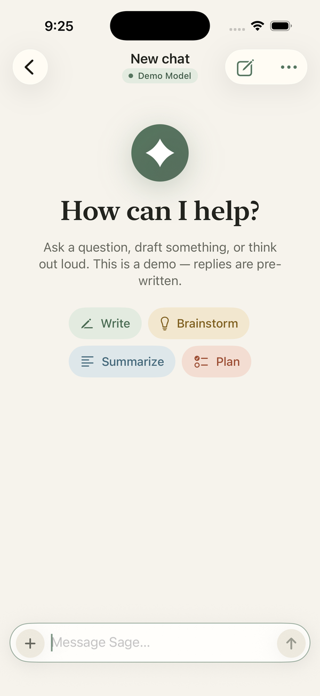
  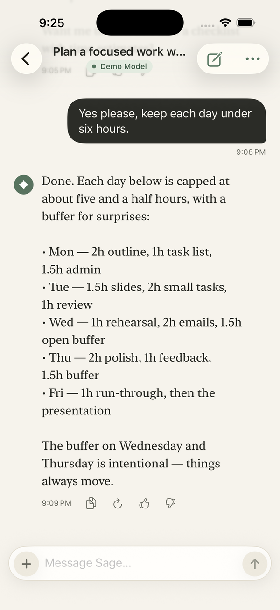

### AI Tools

  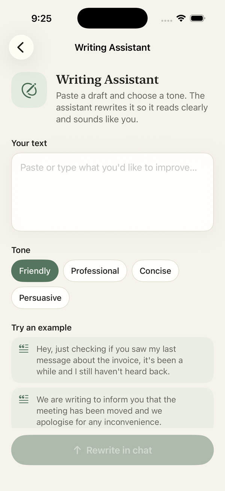
  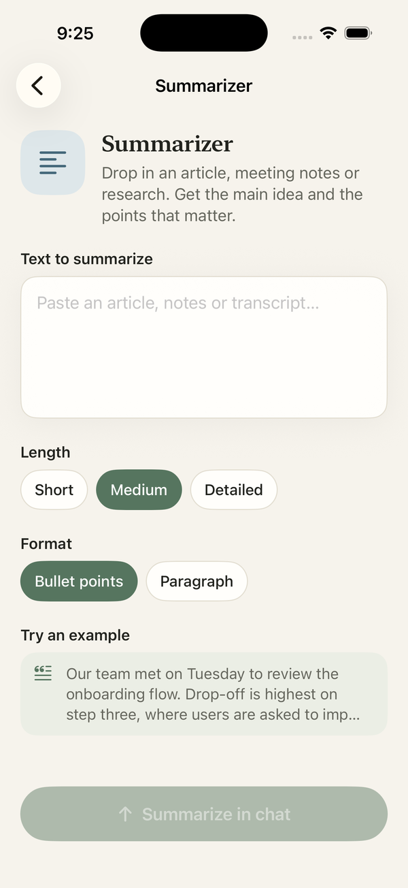

### Settings and Premium preview

  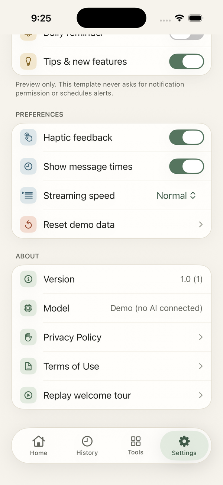
  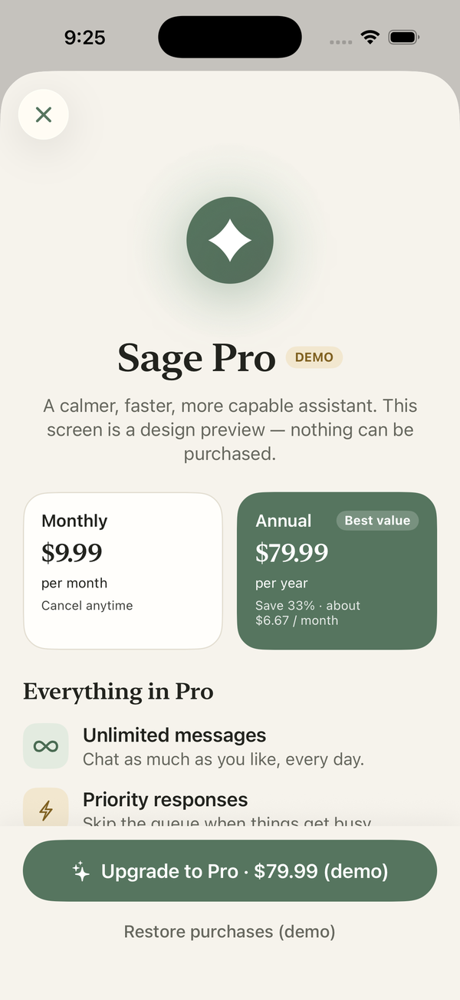
  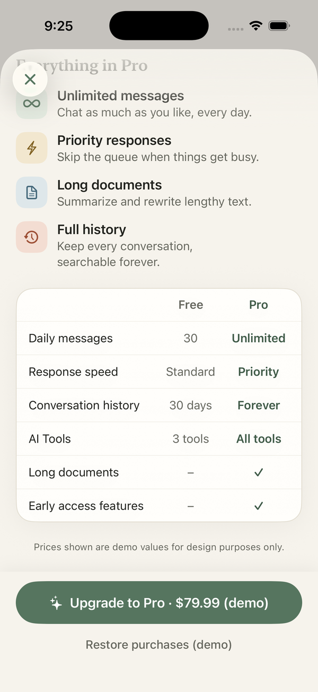

## Get the full source code

**[Buy on Gumroad](https://qinqin4.gumroad.com/l/yzuvug)**
